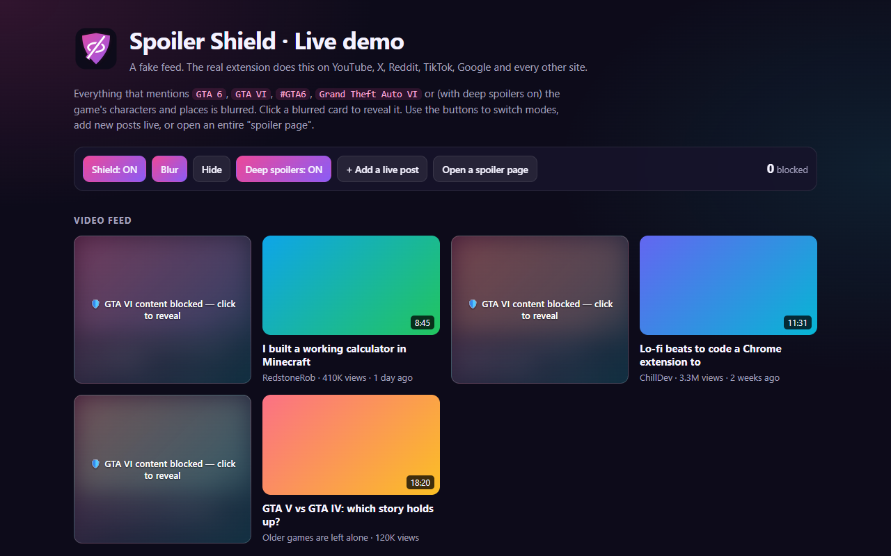
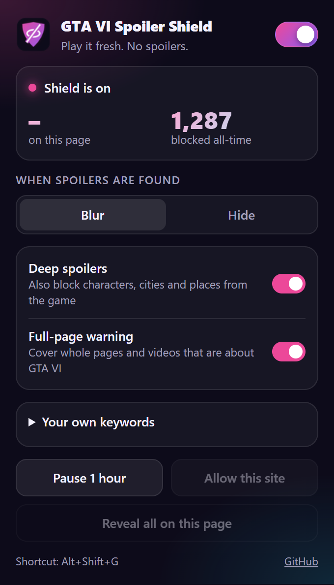
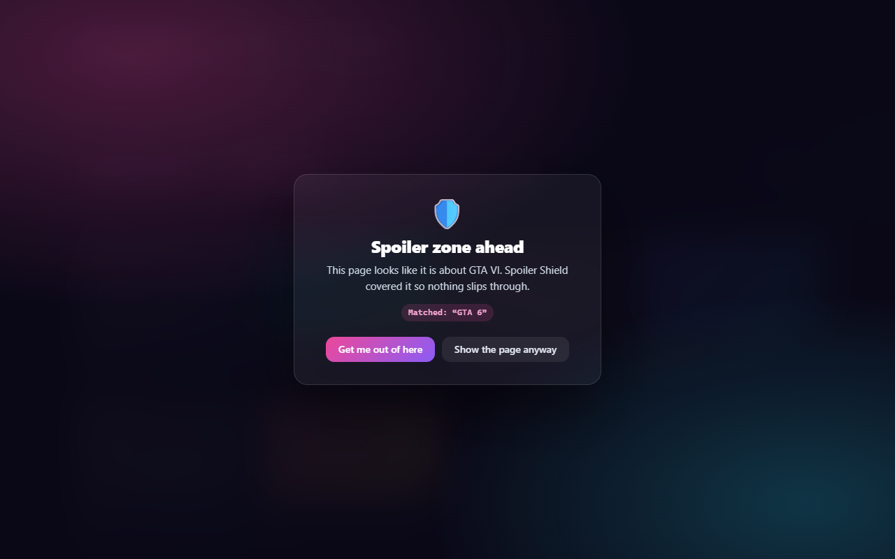
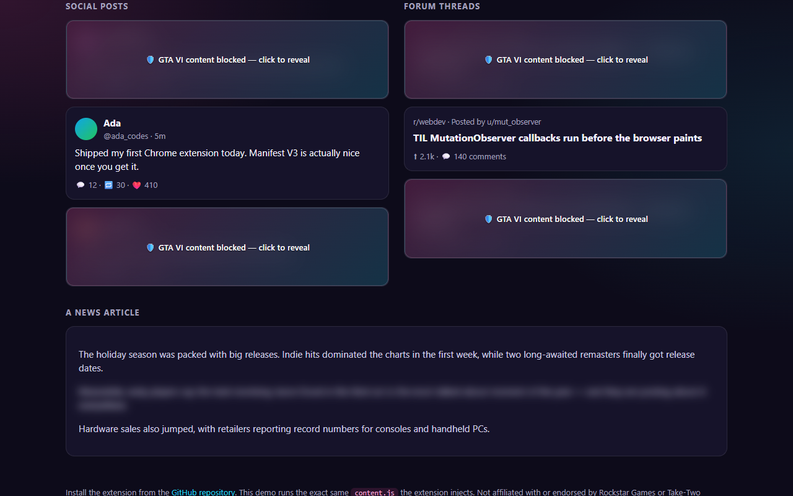

<p align="center">
  
</p>

<h1 align="center">GTA VI Spoiler Shield</h1>

<p align="center">
  <b>Play it fresh. No spoilers.</b><br>
  A Chrome extension that blurs or hides GTA VI spoilers on YouTube, X, Reddit, TikTok, Google, news sites and everywhere else.
</p>

<p align="center">
  <a href="https://github.com/UlasUcan77/gta6-spoiler-shield/actions/workflows/ci.yml"></a>
  
  
  <a href="LICENSE"></a>
</p>

<p align="center">
  <a href="https://ulasucan77.github.io/gta6-spoiler-shield/demo/"><b>▶ Try the live demo</b></a> ·
  <a href="https://github.com/UlasUcan77/gta6-spoiler-shield/releases/latest"><b>⬇ Download</b></a> ·
  <a href="#türkçe">🇹🇷 Türkçe</a>
</p>



## Why

GTA VI is out and the internet is one giant spoiler. Thumbnails, trending tabs, tweets, Reddit megathreads,
"ending explained" videos in your recommendations… If you haven't finished the story yet, Spoiler Shield
covers all of it before you see it, and lets you reveal any single item with one click.

## Features

- **Works everywhere.** Site-aware on YouTube, X/Twitter, Reddit (new and old), TikTok, Twitch, Discord,
  Google Search/News, Facebook, Instagram, Threads, Bluesky and Mastodon, with a generic fallback for every other site.
- **Blocks the whole card, not just the word.** A tweet, a video tile, a Reddit post, a search result. A news article
  only loses the paragraph that mentions the game.
- **Blur or Hide.** Blur shows a "click to reveal" label. Hide removes the item from the page.
- **Full-page warning.** Pages and videos that are *about* GTA VI (a trailer, a walkthrough, a wiki page) get covered
  completely and the video is kept paused. Your own searches are not covered.
- **Deep spoilers mode.** Also catches character names, cities and places from the game (`Jason Duval`,
  `Lucia Caminos`, `Leonida`, `Port Gellhorn`…).
- **Smart matching.** `GTA 6`, `GTA VI`, `GTA6`, `#GTAVI`, `GTA-6`, `Grand Theft Auto VI`, Turkish suffixes like
  `GTA 6'nın`, and even text hidden with zero-width characters. It does **not** match `GTA V`, `GTA IV` or `GTA 60fps`.
- **Your own keywords.** Add them in the popup, or select text on any page → right-click → *Block "…" as a spoiler keyword*.
- **Live.** Infinite scroll, single-page apps and recycled DOM nodes (YouTube does this a lot) are handled with a
  `MutationObserver`. Blocking happens before the browser paints, so there's no flash of spoiler.
- **Allow a site, pause for an hour, or toggle with `Alt+Shift+G`.**
- **English and Turkish UI.**
- **Private.** No network requests, no analytics, no remote code. See [PRIVACY.md](PRIVACY.md).

| Popup | Full-page warning |
| --- | --- |
|  |  |



## Install

### From the release (recommended until the Web Store listing is live)
1. Download `gta6-spoiler-shield-vX.Y.Z.zip` from the [latest release](https://github.com/UlasUcan77/gta6-spoiler-shield/releases/latest) and unzip it.
2. Open `chrome://extensions` and switch on **Developer mode** (top right).
3. Click **Load unpacked** and select the unzipped folder.

Works in Chrome, Edge, Brave, Opera, Vivaldi and other Chromium browsers.

### From source
```bash
git clone https://github.com/UlasUcan77/gta6-spoiler-shield.git
```
Then load the cloned folder with **Load unpacked** as above.

## How it works

```
manifest.json            Manifest V3, permissions: storage + contextMenus
src/matcher.js           Keyword → Unicode-aware RegExp (pure, unit-tested in Node)
src/content.js           Scans text nodes + alt/title/aria-label, picks the right "card", blurs/hides it,
                         watches the DOM with a MutationObserver, shows the full-page warning
src/content.css          Blur / label / hide styles (all prefixed gvs-)
src/background.js        Badge counter, lifetime stats, context menu, keyboard shortcut
popup/                   Settings UI (vanilla HTML/CSS/JS, i18n via _locales)
demo/                    Live demo page that runs the same content.js
tests/                   Unit tests (node:test) + end-to-end tests (Puppeteer + Chrome for Testing)
```

**Matching.** Every keyword becomes a pattern that tolerates separators (`GTA 6`, `GTA-6`, `GTA_6`, `GTA6`)
and is wrapped in Unicode letter/number lookarounds (`(?<![\p{L}\p{N}])…(?![\p{L}\p{N}])`). This keeps out
`GTA V`, `GTA 60fps` and `regatta 6` while still matching Turkish suffixes after an apostrophe.

**Choosing what to hide.** When a text node matches, the script walks up to the nearest known card
(`ytd-rich-item-renderer`, `article[data-testid="tweet"]`, `shreddit-post`, …). If there isn't one, it falls back to
a generic card (`li`, `[class*=card]`, …) as long as it isn't huge, and then to the nearest paragraph or heading.
Cards get a blurred body with a label on top. Plain text blocks get an inline blur.

**No flash.** The content script runs at `document_start` and processes `MutationObserver` records
synchronously. Those callbacks run as microtasks before the next paint, so the user never sees the spoiler.

**Clicks.** A capturing listener on `window` swallows clicks and pointer events on blocked cards. The first click
reveals the card and does not open the link behind it. Children of blocked cards get `pointer-events: none`,
so YouTube's hover previews don't start either.

## Development

```bash
npm install          # installs Puppeteer (only used for tests/screenshots)
npm test             # unit tests for the matcher
npm run test:e2e     # loads the real extension into Chrome for Testing and checks fixture pages
npm run build        # dist/gta6-spoiler-shield-v<version>.zip, ready for the Chrome Web Store
python scripts/make_icons.py      # re-render icons
node scripts/screenshots.mjs      # re-render README / store images
```

CI runs both test suites on every push. Pushing a `v*` tag attaches the zip to a GitHub release.

## Disclaimer

This is an unofficial, fan-made tool. It is not affiliated with or endorsed by Rockstar Games or Take-Two Interactive.
"Grand Theft Auto" and "GTA" are trademarks of Take-Two Interactive Software, Inc.

---

## Türkçe

**GTA VI Spoiler Shield**, GTA VI ile ilgili içerikleri internetin her yerinde bulanıklaştıran ya da tamamen gizleyen bir Chrome eklentisi.
Oyunu bitirmeden önce spoiler yememek için yapıldı.

**Özellikler**
- YouTube, X, Reddit, TikTok, Twitch, Discord, Google, Facebook, Instagram ve diğer tüm sitelerde çalışır.
- Sadece kelimeyi değil, ait olduğu kartın tamamını kapatır (tweet, video, gönderi, arama sonucu).
- **Bulanıklaştır** veya **Gizle** modu. Tek tıkla tek bir öğeyi açabilirsin.
- **Tam sayfa uyarısı:** Tamamen GTA VI hakkında olan sayfaları (fragman, rehber, wiki) kapatır ve videoyu durdurur.
- **Derin spoiler modu:** Karakter, şehir ve mekân adlarını da yakalar.
- `GTA 6'nın`, `GTA VI'ın` gibi Türkçe ekleri tanır. `GTA V` veya `GTA IV` ile karışmaz.
- Kendi anahtar kelimelerini ekleyebilirsin. Sayfada metni seçip sağ tıklaman yeterli.
- Siteye izin ver, 1 saat duraklat veya `Alt+Shift+G` ile aç/kapat.
- Hiçbir veri toplamaz ve hiçbir yere istek atmaz.

**Kurulum:** [Son sürümden](https://github.com/UlasUcan77/gta6-spoiler-shield/releases/latest) zip'i indirip aç →
`chrome://extensions` → **Geliştirici modu** → **Paketlenmemiş öğe yükle** → klasörü seç.

## License

[MIT](LICENSE)
